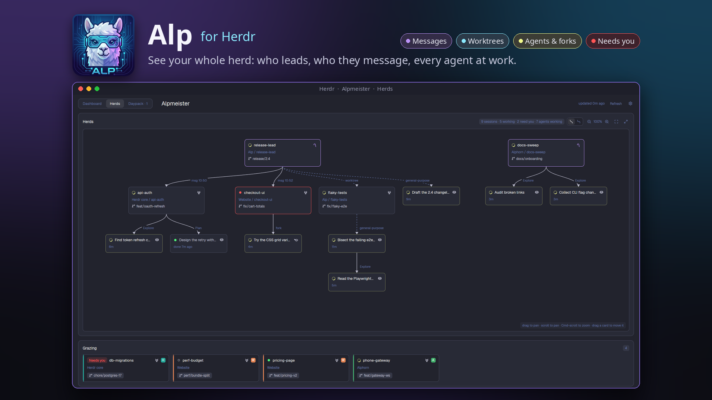

# herdr-alp

A layout for the [Herdr](https://herdr.dev) desktop app, plus the Claude Code plugin that feeds it.

An *Alp* is the high summer pasture of the Swiss Alps: the herd roams the open slopes, unfenced, and the herdsman is up there with it, in charge. This layout is that for coding agents: a sidebar with your account's usage limits, spaces and agents, and a header on every pane with the agent's model, effort, context fill, worktree, branch and status. It comes in [Dracula](https://draculatheme.com) colors.

> [!NOTE]
> **Claude Code only, for now.** The usage limits and the model, effort and context chips come from the `alp` Claude Code plugin. Other agents and shells still get the pane header (name, folder, worktree, status) but no chips. The status files are agent-neutral, so other agents can be added later (see [Status files](#status-files)).



What's inside:

| Path | What it is |
|---|---|
| `layouts/alp.json` | the Herdr layout |
| `themes/alp.json` | its built-in theme: Dracula |
| `mods/usage-limits/` | sidebar block: session (5h) and weekly (7d) usage, with time to reset |
| `mods/pane-agent/` | pane header: icon, name, folder, model/effort/context chips, worktree, branch, status, split/zoom/close |
| `mods/alp-agents/` | sidebar agents list: grouped or priority views, sub-agents under their parent, each Space shown by its avatar |
| `mods/alpmeister/` | a team lead's start-of-day tab: a Dashboard (bugs by priority, triage, customer issues, nightly, priorities, milestone, team in flight) and Daypack (focus, reviews, your PRs, your issues) |
| `mods/daypack/` | Daypack: a right sidebar beside the terminals with today's Lineup items, shown or hidden from a Daypack button in the tab bar |
| `plugins/alp/` | Claude Code plugin that writes the status files the mods read |
| `RECIPE.md` | the brief to rebuild it from scratch (herdr.dev format) |
| `sync.sh` | copy the layout and mods into Herdr's home, or pull live edits back |
| `setup.sh` | one-step install: asks for your Alpmeister settings, then syncs, installs the plugin and opens Alp |
| `setup/settings.py` | the questions `setup.sh` asks, with defaults read from GitHub through `gh` |

## Install

### Quick setup

```sh
git clone https://github.com/ido-galili/herdr-alp && cd herdr-alp
./setup.sh ~/code/your-project        # your project's local clone
```

It walks through the steps below and builds your [Alpmeister settings](#setup) by asking,
with each answer guessed from GitHub. To do it by hand instead:

### 1. Herdr layout and mods

```sh
git clone https://github.com/ido-galili/herdr-alp && cd herdr-alp
./sync.sh install                                   # copies layout, theme and mods into ~/.config/herdr-app
herdr-app do layout.switch '{"name":"alp"}'
```

`ctrl-shift-l` switches back to your previous layout. Alp opens in its own Dracula theme (`alp` in the theme picker, offered only on this layout); picking another theme there overrides it.

Or ask your agent to add `herdr.dev/layouts/ido-galili/herdr-alp`: Herdr's `AGENTS.md` tells it how.

### 2. Claude Code plugin

Without it the layout works, but the usage limits show `–` and the pane headers show no chips. This repository is also a Claude Code plugin marketplace, so in a Claude Code session:

```
/plugin marketplace add ido-galili/herdr-alp
/plugin install alp@herdr-alp
```

Pick a scope when asked (user scope loads it in every session). Or from a shell:

```sh
claude plugin marketplace add ido-galili/herdr-alp
claude plugin install alp@herdr-alp
```

Update it later with `/plugin marketplace update herdr-alp`.

**While developing**, load it straight from this folder instead, in `~/.claude/settings.json`:

```json
{ "env": { "CLAUDE_CODE_PLUGIN_DIRS": "~/projects/herdr-alp/plugins/alp" } }
```

Restart running Claude sessions after installing or changing the plugin.

## Alpmeister

In an alp cooperative, the Alpmeister plans the season and oversees the alp, while the senn
works the herd. The `alpmeister` mod is that view for a team lead, opened as a tab:

```sh
herdr-app do tab.new '{"mod":"alpmeister","name":"Alpmeister"}'
```

It has three tabs: Dashboard, Herds and Daypack.

- **Dashboard:** four tiles (open bugs by priority, triage bugs, open customer issues, the last
  nightly run), the spotlight on the next two milestones, the next milestone (X of Y
  closed, due date, status strip, flags), and
  the board's issues in flight, each flagged when it is outside the current iteration.
- **Daypack:** today's focus (pinned rows and typed todos, carried over the next day), your
  review requests with a Review button, your open PRs, and your issues with a Start button. Both buttons
  open a Claude Code tab running the command set in `launch`, and show only when it is set.
- **Herds:** your Claude Code sessions and how they are linked. A session that messaged others
  (`SendMessage`) or made their worktrees is a herdsman: drawn on top, with a line down to each
  of its herd, labelled `msg 12:36` for its latest message or dotted `worktree`. Who and when
  only: no message text is shown. Sessions with no link graze: a card each, in space order, with a
  stripe in the space's color and its avatar in the corner. Every box and card ends with
  the session's git branch. A click opens
  a session's tab. A background session is shown in the tab titled with its name, or in the
  tab picked with Link a tab. It reads Claude Code's files (`~/.claude/sessions`, the
  sessions' transcripts) and redraws when a session starts, ends or changes status. Open it
  directly with `herdr-app do tab.new '{"mod":"alpmeister","props":{"tab":"herds"}}'`.
- **Refresh:** Dashboard and Daypack fetch when the tab opens and from its Refresh button only. The "updated" time turns
  amber after 2 hours.
- **Settings:** `~/.config/alp/alpmeister.json` names the repository, the project board and its
  status names, the nightly workflow and the Claude commands. It reads GitHub through the `gh`
  CLI and never writes to it. Write it by hand from `mods/alpmeister/alpmeister.example.json`,
  or let `setup.sh` build it by asking (see below).
- **Today's focus** shows each pinned issue's board status and each pinned PR's review
  decision, as of the last refresh.
- **State:** `~/.local/state/alp/focus.json` holds the focus list and
  `~/.local/state/alp/alpmeister-cache.json` the last result.

### Setup

`./setup.sh` builds the settings by asking, one question per setting, each with a default:
your current answer, else a guess from GitHub through `gh`:

| Question | Guessed from |
|---|---|
| Folder the Claude buttons open in | the folder you pass, or the one you run it in |
| Repository | that folder's GitHub remote |
| Project board | the repository's boards: the one with the most items |
| Statuses, and which are not started, in flight, or hidden from Your issues | the board's Status field, read by name (New, Todo, Done, On Hold…) |
| Nightly workflow and its branch | the repository's workflows: one with "nightly" in its name |
| What the Claude buttons type | a plain prompt: `Work on GitHub issue #{number}: read it, plan, then implement.` and `Review GitHub PR #{number} and summarize what needs attention.` Type a `/command` or your own prompt instead |

It shows the result and asks before writing it, keeping the previous file as
`alpmeister.json.bak`. Settings it does not ask about (queries, bugs, spotlight, customer
labels, nightly checks) keep their values or Alpmeister's defaults: edit them by hand, from
`mods/alpmeister/alpmeister.example.json`. Run `./setup.sh --settings-only` to change only
the settings.

## Status files

The plugin and the mods talk through files in `~/.local/state/herdr-agents/`. They are written per agent, so other agents can report later without changing the mods:

- `<herdr terminal>.json`: `{ "agent": "claude", "model", "effort", "context_pct", "ts" }`. Empty when the agent has exited. The pane header shows the chips only when `agent` matches the program running in the pane.
- `limits.json`: `{ "<agent>": { "five_hour": { "used_percentage", "resets_at" }, "seven_day": {…}, "ts" } }`. Each agent replaces only its own key. `usage-limits` takes `props: { "agent": "…" }` (default `claude`).

To add another agent: make it write these files, then add its program key to `REPORTING` in `mods/pane-agent/main.js`.

## Working on it

Herdr hot-reloads its home, so the quickest loop is to edit there and pull back:

```sh
./sync.sh pull      # ~/.config/herdr-app -> repo
./sync.sh install   # repo -> ~/.config/herdr-app
herdr-app check ~/.config/herdr-app/mods/pane-agent
```

## Planned

- A browser tab.
- **senn**, the Alp's herdsman: a mod that steers the agents.

## License

[MIT](LICENSE)
