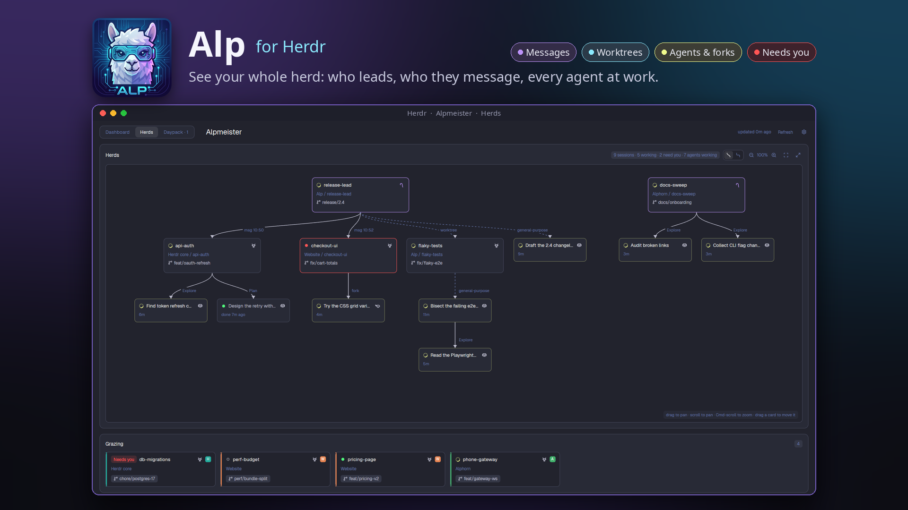

# Alp

A calm, dark Herdr window for running coding agents, where you watch over the herd rather than fence it. A sidebar on the left holds your agent account's usage limits (session and weekly, with how close each reset is), your spaces and your agents. On the right the active tab's panes sit as rounded cards, each with a header showing what runs there: the agent, its folder, its model, reasoning effort and context fill, its worktree and branch, and whether it is working, needs you, or is done.

## What you see

Left to right:

- **Sidebar**, 268px wide (min 44, max 480, not draggable), on the theme's `chrome` background:
  - **Brand row**, 46px: the shipped `workspace-chrome` header (app name, search, sidebar toggle). Drags the window.
  - **Usage limits**, 96px: two rows, `Session` (5-hour window) and `Weekly` (7-day window). Each row: the label (11.5px, `foreground`, medium), the used percentage right after it (semibold, colored by level), and `resets 4h 11m` / `resets 5d 16h` right-aligned in `dim`. Under it an 8px bar with 4px rounding: `border` track, fill in the level color, and a 2×12px `foreground` tick at how far through the window time is (the right end is the reset). Level colors: `accent` below 70%, `working` from 70%, `blocked` from 90%, `dim` with no data (`–`). A 1px `border` line closes the block.
  - **Spaces** and **Agents**: the shipped lists, sharing the rest equally (each at least 90px).
  - **Footer**, 69px: `workspace-chrome` in footer mode (Settings, Add machine).
- **Work area**:
  - **Tabs**, 42px: the shipped tab bar, with the Files / Changes panel buttons. Drags the window.
  - **Body**, 8px padding and gap: the active tab's panes, each a card with `background` fill, 1px `border` outline (1px `accent` when focused), 10px radius, 8px between cards, framed even when alone. To the right a hidden 368px panel (280–900) stacking the shipped `files` and `changes` panels, opened from the tab bar.
  - **Status bar**, 28px: the shipped `workspace-status`.
- Theme: Dracula, shipped as the layout's own theme `themes/alp.json` (background `#282a36`, chrome `#21222c`, border `#44475a`, hover `#343746`, dim `#6272a4`, accent `#bd93f9`, working `#f1fa8c`, blocked `#ff5555`, done `#50fa7b`) and set as the root's `theme`. Every color below is a theme name, so another theme from the picker restyles it all.
- Window: `canvas` background, no title bar (traffic lights at 12,16), 1px `border` dividers, terminal padding 14×12.

**Pane header**, 30px, always shown, at the top of each card, 12px text on `background` with a 1px `border` bottom line. Left to right:

1. The program's icon (14px; tinted `dim` when the program table marks it tintable).
2. Its name (`Claude Code`, the shell, or the terminal's title), medium weight, `foreground`, truncated at 260px.
3. The folder, `~`-shortened, in `dim`, taking the free space.
4. Chips (18px high, 5px radius, `hover` fill, 10.5px text), only for an agent that reports status: the model (`claude-opus-5-5` → `Opus 5.5`) in `foreground`; the reasoning effort, capitalized, in `accent`; the context fill as a 44×5px bar plus percentage, colored by the same levels as the limits.
5. A worktree chip in `working` color with a branching icon and the worktree's name, when the folder is a linked git worktree.
6. A branch chip `⎇ main` in `muted`, for reporting agents.
7. Status: a 12px spinner in `working` color while working; a `Needs you` chip (semibold, `blocked` text on `blocked` at 15% opacity) when blocked; a 7px `done` dot when done; nothing when idle.
8. Four 14px icon buttons in `dim` (hover: `hover` fill, `foreground`): split right, split down, zoom/unzoom, close.

## How it behaves

- **working**: spinner turning once every 900ms in the pane header; the shipped agents list and tabs show their own state.
- **blocked**: `Needs you` chip in the header.
- **done**: a small `done`-colored dot.
- **idle**: no status mark.
- Clicking a pane header focuses that pane. The four buttons split it right or down, zoom/unzoom it, or close it; their clicks don't also focus.
- The chips follow the agent live: a `/model` or `/effort` change shows on the next prompt, the context bar after each answer. After `/clear` the context bar disappears until the next answer; when the agent exits, all its chips disappear.
- If something else runs in the terminal later, stale chips stay hidden: they show only when the status file's `agent` matches the program in the pane.
- The limits refresh every 5 seconds and the "resets in" text every 30 seconds. With the sidebar folded under 160px the block becomes a 32px rail cell: a gauge icon, the session percentage, a 24×3px bar and a clock with the time to reset (`4h`, `12m`); the full text is its tooltip. The cell has the same 10px top padding as the unfolded rows, and the block shrinks from 96px to 82px so the space under it matches too; unfolding restores 96px.

## Built from

- **Layout** `layouts/alp.json`, cloned from the shipped `main` (0.1.14): `root` row with `"theme": "alp"` → `sidebar` column (`brand` block, `sidebar-lists` column of `limits` / `spaces` / `agents` blocks, `sidebar-footer` block) and `work` column (`tabs` block, `work-body` row of `main` block + hidden `panel` column with a `panel-body` stack of `files` / `changes`, `status` block). `main` shows `{ "tab": "active" }` with a `pane` frame whose `header` is `{ "content": { "mod": "pane-agent" }, "reveal": "always", "height": 30, "position": "top" }`.
- **Shipped mods used**: `workspace-chrome` (brand, and footer with `props: { footer: true }`), `spaces`, `agents`, `tabs`, `files`, `changes`, `workspace-status`. Art borrowed from them: `mods/workspace-chrome/clock.svg`, `mods/workspace-chrome/spinner.svg`.
- **`mods/usage-limits`**: a `View` reading `~/.local/state/herdr-agents/limits.json` with `readTextFile(home() + …)`, picking the entry for `props.agent` (default `"claude"`). Uses `theme()` and `layout()` (sidebar width for the rail), and `run("layout.resize", { id: "limits", px })` when the fold state changes. Props: `agent`, `block` (default `"limits"`), `height` (96), `foldedHeight` (82). Art: `gauge.svg`.
- **`mods/pane-agent`**, cloned from the shipped `pane` (0.1.14): `panes()` + `props().pane` for its pane; `readTextFile` of `~/.local/state/herdr-agents/<terminal>.json` every 3 seconds; `exec("git", ["rev-parse", "--path-format=absolute", "--git-dir", "--git-common-dir"])` in the pane's folder (a worktree when the two differ; the worktree name is the git dir's last part); `run("pane.focus" | "pane.split" | "pane.zoom" | "pane.close")`. Art: `close`, `split-down`, `split-right`, `zoom`, `unzoom`, `worktree` SVGs.
- **`plugins/alp`**: a Claude Code plugin (hooks module) that writes the status files; nothing in Claude's own status line. Inside a Herdr terminal (`HC_TERMINAL_ID` set) it writes `<terminal>.json` as `{ agent: "claude", model, effort, context_pct, ts }` on `session.start`, on each main-thread `turn.step` (model, effort) and on `session.measure` (context); on `session.end` it empties the file, or after `/clear` only drops `context_pct`. On `session.measure` with rate limits it rewrites only its own entry in `limits.json`: `{ "claude": { five_hour: { used_percentage, resets_at }, seven_day: {…}, ts } }`.

## Watch out

- The theme is named like the layout (`themes/alp.json`) so it is Alp's own and can't clash with a `dracula.json` the person already has; Settings offers it only on this layout. Picking a theme in the picker rewrites the layout's root `theme`.
- Mod art paths are relative to Herdr's home (`mods/pane-agent/zoom.svg`): renaming a mod means renaming its paths too.
- `pane-agent` compares the file's `agent` along with model, effort and context before redrawing; leave `agent` out and a file from another agent keeps showing the old chips.
- `limits.json` is shared by every agent that reports: read it, change your own key, write it back; never overwrite the whole file.
- Context fill is absent right after `/compact` until the next answer; show nothing rather than 0%.
- A Claude Code session keeps the plugin it started with: after installing or changing the plugin, restart running sessions before expecting chips.
- Only Claude Code reports today: the program keys that get chips are the `REPORTING` set at the top of `pane-agent/main.js`.
- The model name shortening only knows `claude-<family>-<major>[-<minor>]`; other ids show as they are.
- Usage limits show `–` until the first answer of any Claude session after the plugin is installed.
- A layout block has no content-fit size: padding alone can't remove the empty space under the folded cell, so `usage-limits` resizes its own block. It does so only when the fold state changes (render re-runs on every layout change), and the block id in the layout must match its `block` prop.

## Alpmeister

A tab mod, `mods/alpmeister`, for a team lead's start of day. It is not placed by the layout:
open it with `tab.new {mod: "alpmeister"}`.

- **What you see**, top to bottom on the `canvas` background, 18px padding, cards with 10px
  radius and a 1px `border`:
  - A header: two pill tabs, Dashboard and "Daypack · N" (N open focus items), then "Alpmeister"
    (18px semibold), "updated 4m ago" in `dim` (`working` after 2 hours), and a Refresh text
    button. Each copy remembers its tab in localStorage.
  - **Dashboard**, top to bottom:
    - Four tiles, in one row when the tab is at least 1000px wide, else two by two: open bugs by
      priority (total, a strip and a chip per priority, counted from the priority issue field),
      triage bugs, open customer issues (any label whose name contains `customer.labelMatch`,
      named under the count), and the last nightly run.
    - The nightly tile: "Success", "Failure" or "Running" for the last run, its local start date
      and time ("Tue 17 Nov, 06:05"), then one line per
      `nightly.checks` entry (deploy, unit, API and E2E tests) with an outcome chip. A check
      matches jobs by name, a step inside them, or every job except some.
    - The Spotlight card, derived from the issues of the next two milestones. One column per
      milestone, side by side when wide:
      - Its open issues with a priority value, a `spotlight.labels` label or a
        `spotlight.featureTypes` type. Most urgent first, then by feature type.
      - Each row shows its issue type beside the number, then its priority or label, an epic's
        "X of Y" sub-issues, its status, and an Unassigned flag. Rows show no due dates.
      - 8 rows, then "Show N more".
      - Below the columns, "To discuss": the issues in `spotlight.holdStatus` in either milestone.
    - The next milestone card: its title (20px) with "1 of 12 closed", a usage-limits style bar
      (closed share, tick at the time gone since the previous milestone's due date, `working`
      when behind the tick), a 6px strip of board-status segments, a chip per status, and
      `Needs you` style flags for unassigned issues and for `notStarted` issues (New, Todo by
      default) in the last 7 days.
  - Team in flight, full width: the board's open issues in the configured statuses, grouped in
    board order, with toggles for the next milestone and the current iteration, 5 rows per group with "Show N more". Flagged rows first: a row outside the
    current iteration gets a warning chip naming its iteration or "No iteration". Chips for
    assignee, milestone, days in status and each linked PR's review state.
  - **Daypack.** Today's focus across the top: a todo input, then Todos, PRs and Issues, each
    under a heading with its open count. A row: checkbox, number, title, the issue's board
    status or the PR's review decision (Approved, Changes Requested, In Review, or Merged or
    Closed), days since it was added (from the next day), a Claude button, Remove. Items stay
    until removed. Below it, two columns:
    - The PRs that need your attention (author, age, checks, Pin, Review), then My PRs: your
      open, non-draft PRs (`queries.myPrs`) with the review decision, checks and age (Pin,
      Review).
    - Your issues grouped by status, current iteration only by default (Pin, Start).
- **How it behaves:** a click on a row opens it on GitHub. Pin adds the row to today's focus. A
  pinned issue or PR checks itself once it closes or merges; each refresh reads every pick's
  state, board status and review decision, checked or not, and keeps them on the item. Review and Start open, when configured, a tab running
  `claude` with the configured command, in the space you are in. The tab starts in the live
  folder of that space's first tab (its first pane's `cwd`) when it is `launch.folder` or inside
  it, such as a worktree, else in `launch.folder`.
  The Daypack's Claude buttons do the same. It fetches when the tab opens and on Refresh only.
- **Built from:** `config.js` (settings), `queries.js` (one GraphQL document for everything but
  the nightly run), `data.js` (`gh api graphql`, `gh api` for workflow runs and jobs),
  `focus.js` (the focus file, written with `writeTextFile` over the last read version),
  `project.js`, `in-flight.js`, `my-day.js`, `focus-list.js`, `ui.js`, and `main.js`.
- **Watch out:** issue search cannot filter on a board field, so in-flight items come from the
  project's own `items(query:)` filter. GitHub milestones have no start date. The runtime has no
  locale data, so dates are formatted by hand. Without a `mod.json` with `"place": "none"`, Herdr
  docks a copy of the mod into the shown layout the first time it sees the folder.
- **Done when:** `herdr-app check` passes, and the milestone headline, triage count, team PR
  count and in-flight groups match the same queries run with `gh`.

## Done when

- `herdr-app check` passes for `mods/usage-limits` and `mods/pane-agent`, and `herdr-app do layout.switch '{"name":"alp"}'` returns ok with no errors in `herdr-app status`.
- A new Claude Code session in a Herdr terminal shows its model, effort and context chips in the pane header within 3 seconds of its first answer, and `~/.local/state/herdr-agents/<terminal>.json` holds `"agent":"claude"`.
- Changing the file's `agent` to anything else hides the chips within 3 seconds.
- The sidebar shows Session and Weekly percentages and reset times matching `limits.json`, and folding the sidebar shows the rail cell with the same space above and below it as the unfolded rows (the `limits` block at 82px), back to 96px when unfolded.
- Exiting Claude empties the terminal's file and its chips disappear.

## Daypack

- **What:** what you carry through the day, in a column on the window's right edge, beside the
  terminals as the left sidebar is. It holds today's Lineup items. A Daypack button at the right
  end of the tab bar shows or hides it.
- **Where:** `mods/daypack/`, placed twice by the `alp` layout:
  - the `daypack-button` block, 40px, beside the `tabs` block in a `topbar` row, with
    `props: { button: true }`;
  - the `daypack` block, the root row's last child: 280px, 200 to 480px, hidden at first.
- **How it looks:**
  - The button is the backpack icon alone (`backpack.svg`, lucide) in a 26px square, like the
    tab bar's + button. The icon is `accent` while any item is open. The button is `selected`
    while the sidebar shows, and runs `layout.toggle`.
  - The sidebar is `chrome`: a 42px "Daypack" header with the open count and a close button
    (`layout.hide`), then a "LINEUP" group
    with the items in sections by kind (Todos, PRs, Issues), each headed by its open count.
    A row holds the item's checkbox, title and number. A click on a title opens it on GitHub.
  - An issue or PR row ends with the Claude button: it opens a Claude tab running the `launch`
    command from Alpmeister's settings, as Alpmeister's Start and Review buttons do. The button
    shows only when that command is set.
- **State:**
  - The layout keeps whether the sidebar shows, as it does for the left sidebar.
  - It reads and writes `~/.local/state/alp/focus.json`, the file Alpmeister keeps. Mods cannot
    import across folders, so `focus-file.js` is its own reader of that format.
  - Each side sets `shared("alp.focusStamp")` after a write, and the other reloads the file.
